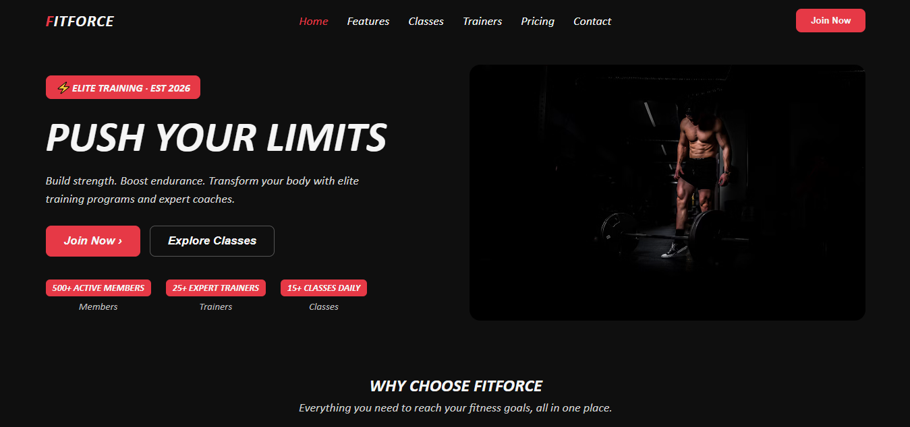

# OIBSIP - Web Development & Designing - Task 1: Landing Page

Submitted for the AICTE Oasis Infobyte Student Internship Program (SIP), Web Development & Designing, Level 1.

- **Intern:** Destine Magumo
- **Task:** Task 1 - Landing Page (FITFORCE gym)
- **Live demo:** https://fitforceweb.vercel.app/
- **LinkedIn post:** (https://lnkd.in/p/d4GM9vZT)

## Objective

Design and build a landing page for a gym brand called FITFORCE using HTML5 and CSS3, with a clear layout, strong visual design and a call to action that guides visitors.

## Steps Performed

1. Planned the page sections and the look of the FITFORCE brand.
2. Wrote the page structure in semantic HTML5.
3. Styled the page with CSS3 (layout, colours, typography, buttons, hover effects).
4. Checked the page in the browser at different screen sizes and fixed layout issues.
5. Pushed the project to GitHub and published it with GitHub Pages.

## Tools Used

- HTML5
- CSS3
- Visual Studio Code
- Git and GitHub
- GitHub Pages (hosting)

## Outcome

A finished FITFORCE gym landing page, built from scratch for this internship and live online at the link above.

<!-- Add a screenshot of the page here:

-->

## Contact

Email: magumodestiny@gmail.com | GitHub: [magumodestin](https://github.com/magumodestin) | LinkedIn: [Destine Magumo](https://www.linkedin.com/in/destine-magumo-913571329/)
